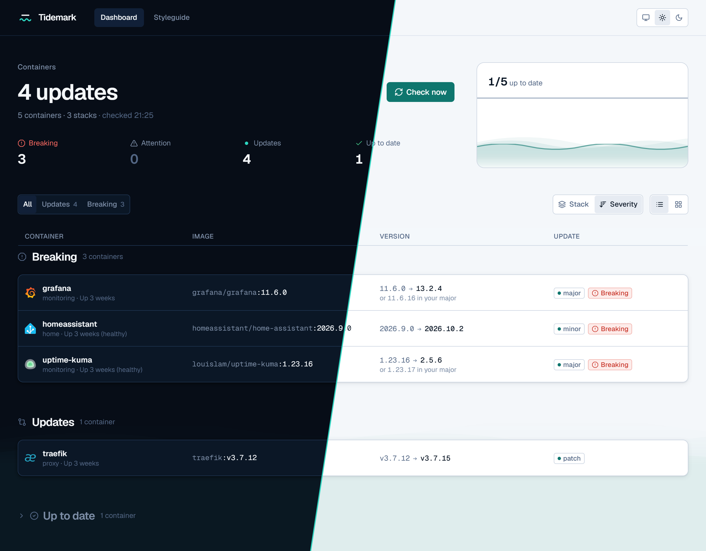

<picture>
  <source media="(prefers-color-scheme: dark)" srcset="docs/brand/banner-dark.png">
  
</picture>

**Know what changed before you update.** A self-hosted dashboard that shows, for every container on your Docker host, the version you run, the latest version, the changelog in between and whether anything in it is breaking.

- **Real versions, not just tags.** `:latest` and `:16-alpine` are resolved to the actual version via image labels, registry digests or the image's own `*_VERSION` variable, and the UI says how it found out.
- **Same family only.** `1.4-alpine` is compared with other `-alpine` releases, never with `-debian`. Updates are classed as patch / minor / major / new image.
- **Release notes in between,** from GitHub or GitLab releases (or `CHANGELOG.md`), with compare links.
- **Breaking-change flags.** Release notes are scanned for things like "BREAKING", "action required" and removed options. Each update gets a risk level (none / attention / breaking) with the reasons, and the lines that triggered it are highlighted.
- **Reviewed, snoozed, history.** Mark an update as read up to its latest version, or snooze it for a while or until a newer version; a History tab lists the image changes Tidemark has seen per container.
- **Telegram notifications** for new updates only, breaking ones first, with an optional daily digest or a breaking-only mode.
- **Per-container rules** via labels or a config file: ignore, pin to `1.4.x`, no majors, include pre-releases, custom tag pattern, source repo override.
- **Read-only and private.** Tidemark never changes your containers. It talks to Docker through a read-only socket proxy and never reads container environment variables.



Status: **in daily use on a home server.** Checking, changelogs, breaking-change highlighting, rules, reviewing and snoozing, update history and Telegram notifications are done. Next on the [roadmap](docs/ROADMAP.md): AI changelog summaries and gated one-click updates. Only public images are supported.

## Run it with Docker

```sh
cp compose.example.yaml compose.yaml
mkdir -p data && sudo chown 65532:65532 data   # the image runs as a non-root user (uid 65532)
docker compose up -d
```

Images are published to `ghcr.io/bartvs98/tidemark` (linux/amd64) for each release, listed on the [Releases](https://github.com/bartvs98/Tidemark/releases) page:

- `latest`: the newest release
- `1`, `1.2`: the newest release in that line
- `1.2.3`: fixed

To build from a checkout instead, replace `image:` with `build: .` and run `docker compose up -d --build`. The compose file also works as a stack in a Docker manager like Portainer; `./data` is then relative to the stack's directory.

A named volume (`- tidemark-data:/data`) works too and needs no `chown`: Docker fills a new volume from the image, which already gives `/data` to uid 65532. The image has no shell, though, so to use a rules file, mount it separately:

```yaml
    volumes:
      - tidemark-data:/data
      - ./tidemark/config.yaml:/config.yaml:ro
    environment:
      TIDEMARK_CONFIG: /config.yaml
```

Then open http://your-server:8080. Tidemark has no login, so keep it on your LAN or behind a reverse proxy that limits access (the compose file has commented Traefik labels). The first check runs at startup, and then every 6 hours. You can also start one with **Check now**.

The compose file runs [docker-socket-proxy](https://github.com/Tecnativa/docker-socket-proxy) next to Tidemark with only `CONTAINERS=1 IMAGES=1` and `POST=0`. Don't mount the Docker socket into Tidemark directly: socket access is root-equivalent, and mounting it `:ro` doesn't restrict the API.

Recommended: create a [GitHub fine-grained token](https://github.com/settings/personal-access-tokens) with read access to public repositories only, and put it in a `.env` file next to `compose.yaml` as `GITHUB_TOKEN=…`. Without it, GitHub allows 60 requests an hour, which is enough for a small host but runs out quickly with many updates.

### What Tidemark connects to

| Where | Why |
|---|---|
| Docker Engine API (via the socket proxy) | List containers and images (`GET` only; container inspect is never called) |
| Container registries (Docker Hub, GHCR, Quay, lscr.io, …) | Tag lists and manifest digests, anonymously; `HEAD` where possible, which doesn't count towards Docker Hub's pull limit |
| GitHub / GitLab | Release notes and `CHANGELOG.md` for containers with an update; GitHub's remaining API quota when you open Settings (that lookup doesn't count against it) |
| api.telegram.org | Only with notifications on: the messages, sent with your bot token |
| cdn.jsdelivr.net | App icons from [selfh.st/icons](https://selfh.st/icons/) (`TIDEMARK_ICONS=off` to disable, or `TIDEMARK_ICONS_URL` for a mirror) |

Nothing else: no telemetry, no accounts.

## Configuration

Everything can be set by environment variables. The settings marked ✎ can also be changed in the Settings dialog (gear in the header) once you set `TIDEMARK_SETTINGS_EDITABLE=true`. Changes apply right away, without a restart. An env var always wins: its field shows as locked. Otherwise the value saved in the dialog counts, then the default.

| Env var | Default | |
|---|---|---|
| `TIDEMARK_ADDR` | `:8080` | Listen address |
| `TIDEMARK_DATA_DIR` | `./data` (`/data` in Docker) | SQLite database (check results, release notes, reviews, history), icon cache, default location of `config.yaml` |
| `TIDEMARK_CONFIG` | `<data dir>/config.yaml` | Optional rules file, re-read on every check; a missing file means no file rules |
| `TIDEMARK_SCHEDULE` ✎ | `0 */6 * * *` | When to check for updates: cron, `@daily` or `@every 3h`, in the server's time zone unless prefixed with `CRON_TZ=Europe/Amsterdam `. `off` to only check on demand |
| `TIDEMARK_GITHUB_TOKEN` ✎ | — | Optional, recommended: a fine-grained token with public repositories read-only; raises GitHub's limit from 60 to 5000 requests/hour. Only sent to api.github.com |
| `TIDEMARK_DOCKER_HOST` | `unix:///var/run/docker.sock` | Docker Engine API, e.g. `tcp://socket-proxy:2375` |
| `TIDEMARK_ICONS` ✎ | `on` | `off` disables app icons (no requests to the icon CDN) |
| `TIDEMARK_ICONS_URL` ✎ | `https://cdn.jsdelivr.net/gh/selfhst/icons` | Icon base URL, e.g. a self-hosted mirror |
| `TIDEMARK_TELEGRAM_BOT_TOKEN` ✎ | — | Turns on [notifications](#notifications), together with the chat ID. Only sent to api.telegram.org |
| `TIDEMARK_TELEGRAM_CHAT_ID` ✎ | — | Chat to send to: your user ID, a group's ID (negative) or `@channelname` |
| `TIDEMARK_NOTIFY_LEVEL` ✎ | `all` | Lowest level that's sent: `all`, `attention` or `breaking` |
| `TIDEMARK_NOTIFY_DIGEST` ✎ | — | Cron spec for one digest message, e.g. `0 9 * * *` (`CRON_TZ=` works as for the schedule, `off` doesn't); without it a message goes out after each check run that finds something new |
| `TIDEMARK_PUBLIC_URL` ✎ | — | Where you open Tidemark, e.g. `https://tidemark.example.lan`; used for links in messages |
| `TIDEMARK_LOG_LEVEL` | `info` | `debug`, `info`, `warn`, `error` |
| `TIDEMARK_SETTINGS_EDITABLE` | `false` | `true` lets the Settings dialog change the ✎ settings. Off by default because Tidemark has no login: anyone who can open it could then redirect your notifications. Saved values, tokens included, are stored in the database in the data dir |
| `TIDEMARK_DOCKER_SNAPSHOT` | — | Read containers from a `scripts/snapshot.sh` file instead of Docker (development, see [Snapshots](#without-docker-snapshots)) |

An invalid value in any of these variables stops startup (the dialog checks its fields the same way), and so does setting only one of the Telegram variables, unless settings are editable and the other one is saved in the dialog. `off` (schedule, icons) is case-insensitive. Registry requests are anonymous, so a private or missing image shows "not found, or private".

### Per-container rules

Set them as container labels, or in the config file. Labels win over the file (full precedence and edge cases: [Features → Rules](docs/FEATURES.md#8-rules)).

| Label | Config key | Effect |
|---|---|---|
| `tidemark.ignore=true` | `ignore` | Don't check this container at all: no registry or GitHub calls. It's listed in a collapsed "Ignored" group |
| `tidemark.pin=1.4` | `pin` | Only versions starting with this prefix count as updates (`1.4` → 1.4.x, `16` → 16.x). May start with `v` |
| `tidemark.allow-major=false` | `allow-major` | Only report updates within the running major |
| `tidemark.prerelease=true` | `prerelease` | Pre-release tags count as updates, and their releases show in the changelog |
| `tidemark.tag-pattern=^\d+\.\d+\.\d+-alpine$` | `tag-pattern` | Only registry tags matching this regex count as versions, both for the latest version and for finding the running one |
| `tidemark.repo=github.com/owner/name` | `repo` | Where to get release notes, when Tidemark can't tell or guesses wrong. Only GitHub and GitLab; another host is ignored |

Booleans accept `true/false/yes/no/1/0` in any case. In the config file, `containers:` matches by container name and `images:` by image repository without a tag; both allow `*` and `?` globs:

```yaml
# data/config.yaml
containers:
  vaultwarden:
    allow-major: false
  "immich-*":
    ignore: true
images:
  postgres:            # matches postgres:16-alpine, docker.io/library/postgres:16, …
    pin: "16"
  linuxserver/sonarr:  # no registry: also matches lscr.io/… and ghcr.io/…
    prerelease: true
  ghcr.io/foo/bar:
    repo: github.com/foo/bar-src
```

Edits apply on the next check, without a restart. A version a rule holds back is still shown, quietly ("18.6 held back by pin 16"). Invalid values are skipped and flagged on the dashboard; a file that doesn't load is reported there too, and the last good one stays in use.

Other labels: `tidemark.icon=<selfh.st reference>` picks an icon (`tidemark` is Tidemark's own, built in), `tidemark.icon=none` hides it.

### Notifications

Tidemark can send a Telegram message when a check finds new updates. Each update is sent once (again only if it turns out riskier, or a snooze runs out), so you won't get the same list every six hours. What's sent and when: [Features → Notifications](docs/FEATURES.md#10-notifications).

1. Message [@BotFather](https://t.me/BotFather), send `/newbot` and copy the token it gives you.
2. Send your new bot any message, then open `https://api.telegram.org/bot<token>/getUpdates` and copy `"chat":{"id":…}`. For a group, add the bot to the group first; group IDs are negative.
3. With `TIDEMARK_SETTINGS_EDITABLE=true`, paste both into **Settings → Notifications** and save. Or add them to the `.env` file next to `compose.yaml` and pass them through:

```yaml
    environment:
      TIDEMARK_TELEGRAM_BOT_TOKEN: ${TELEGRAM_BOT_TOKEN:-}
      TIDEMARK_TELEGRAM_CHAT_ID: ${TELEGRAM_CHAT_ID:-}
      TIDEMARK_PUBLIC_URL: https://tidemark.example.lan   # optional: links in messages
```

Restart (env vars only), open Settings and use **Send test message**. The first check run after that sends one message with every update that's pending now.

## Development

Requirements: Go 1.26+, Node 24+.

```sh
# backend on :8080
go run ./cmd/tidemark

# frontend on :4200, proxies /api to :8080 (second terminal)
cd web
npm install
npm start
```

Open http://localhost:4200.

### Without Docker: snapshots

`scripts/snapshot.sh` exports a Docker host's container and image metadata to JSON. It leaves out container environment variables, mounts and networks (from the image environment it keeps only `*_VERSION` variables); from labels it keeps Compose, `tidemark.*` and image metadata labels. Run it on the server, copy the file into `snapshots/` (git-ignored), then:

```sh
TIDEMARK_DOCKER_SNAPSHOT=snapshots/home.json go run ./cmd/tidemark
```

In PowerShell: `$env:TIDEMARK_DOCKER_SNAPSHOT="snapshots/home.json"; go run ./cmd/tidemark`. The file is re-read on every request, so a new snapshot needs no restart.

### Tests and checks

```sh
go test ./...
go vet ./... && gofmt -l .
cd web && npx ng test --watch=false
```

`node scripts/dev/verify.mjs` builds everything, runs the binary against a snapshot and screenshots the dashboard and styleguide in Chrome/Firefox, light/dark, desktop/phone (`--help` for options; `npm install --prefix scripts/dev` once).

### Single binary

```sh
cd web && npx ng build && cd ..
go build -o tidemark ./cmd/tidemark    # embeds web/dist/spa
```

## Docs

- [Features](docs/FEATURES.md): behaviour and decision rules
- [Architecture](docs/ARCHITECTURE.md): stack, pipeline, data model, API, frontend, security, CI
- [Roadmap](docs/ROADMAP.md)
- [Brand](docs/BRAND.md) and [design system](docs/DESIGN-SYSTEM.md) (live at `/styleguide`)

## Credits

App icons by [selfh.st/icons](https://selfh.st/icons/), licensed [CC BY 4.0](https://creativecommons.org/licenses/by/4.0/).

## License

[MIT](LICENSE). The app icons (above) keep their own CC BY 4.0 license.
